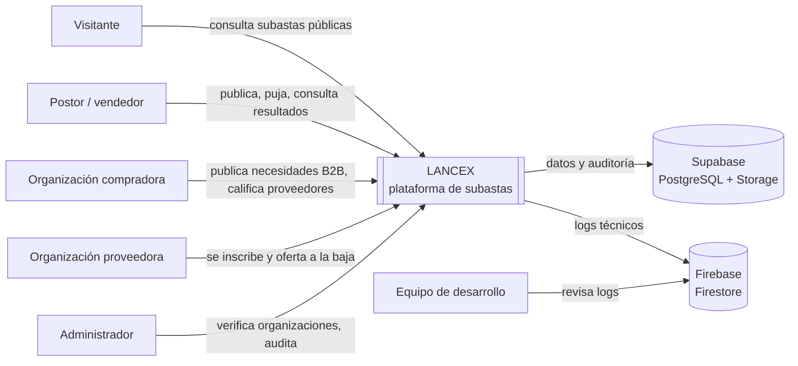
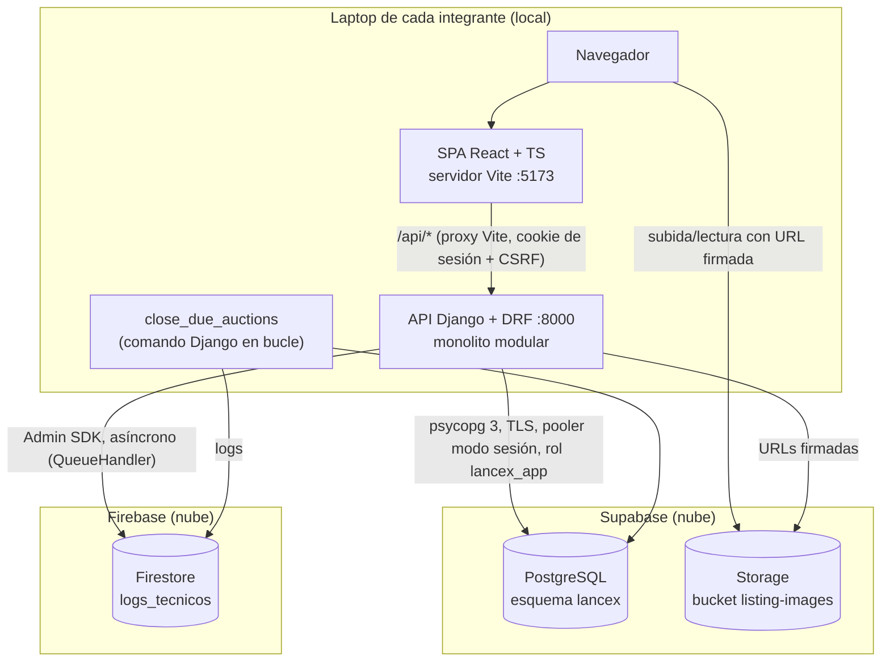
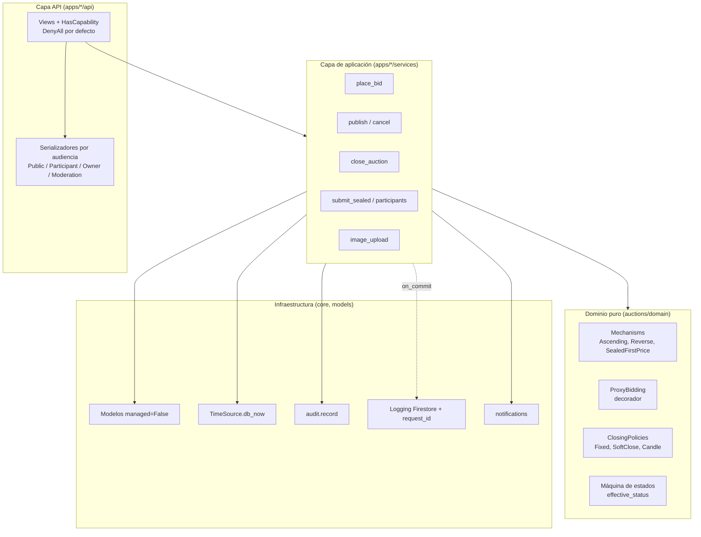

# Arquitectura de LANCEX

Estilo: **monolito modular en capas**, organizado por dominios, con núcleo de reglas en Python puro. Sin microservicios. Decisiones detalladas en [`decisiones/`](decisiones/README.md); drivers y escenarios en [`ATRIBUTOS-DE-CALIDAD.md`](ATRIBUTOS-DE-CALIDAD.md).

## Por qué un monolito modular

- Tres personas desarrollan y entienden un único backend.
- Las reglas de puja, cierre, máximos y ganador necesitan transacciones dentro de una misma frontera de persistencia.
- Las modalidades comparten cuentas, organizaciones, catálogo, auditoría y resultados.
- Los módulos internos separan responsabilidades sin distribuir el sistema.

## C4 nivel 1: contexto

## C4 nivel 2: contenedores

## C4 nivel 3: componentes del backend

Regla de dependencias: `api → services → domain`. `domain` no importa Django. Ninguna app importa la capa `api` de otra.

## Capas

- **API/presentación:** vistas, permisos, serializadores por audiencia, traducción de errores de dominio a HTTP.
- **Aplicación:** casos de uso transaccionales (publicar, pujar, cerrar, inscribir, revelar).
- **Dominio:** mecanismos, políticas de cierre, proxy, estado efectivo, validaciones y selección de ganador.
- **Infraestructura:** modelos ORM sin migraciones, hora de PostgreSQL, auditoría, logs, notificaciones, Storage.

La lógica crítica no vive en serializadores, vistas ni componentes de React.

## Datos y autoridad

- Supabase PostgreSQL es la fuente de verdad. Esquema en SQL versionado (ADR-0003).
- Django se conecta como `lancex_app` (sin DDL). El navegador no accede a la base.
- La hora de negocio es la de PostgreSQL (ADR-0004).
- La auditoría vive junto a los datos transaccionales; los logs técnicos, en Firestore (ADR-0002).

## Concurrencia, cierre y tiempo real

Resumen de ADR-0005 y ADR-0004:

- Pujas serializadas por subasta con `SELECT ... FOR UPDATE`; orden por `seq`; idempotencia por `Idempotency-Key`.
- Estado efectivo calculado en cada lectura; cierre materializado por un job idempotente (`SKIP LOCKED`) que cualquiera de los tres backends puede ejecutar.
- Polling con versión y `304`; sin WebSockets ni Redis.

## Vista de despliegue

No hay despliegue en servidores propios. Cada integrante ejecuta SPA, API y job en su laptop; Supabase y Firebase son servicios gestionados compartidos. La demo se realiza desde una laptop designada con el mismo procedimiento de `CONFIGURACION-LOCAL.md`.
