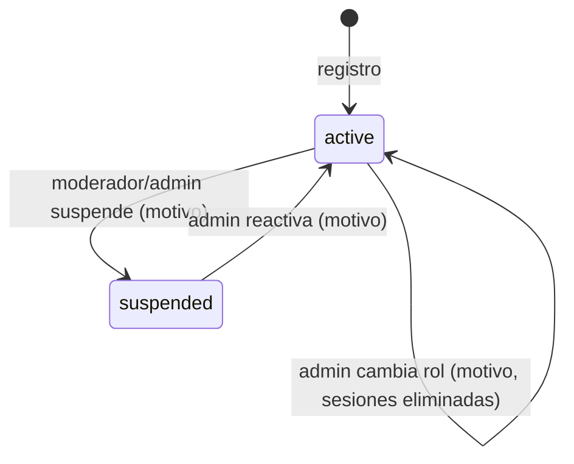
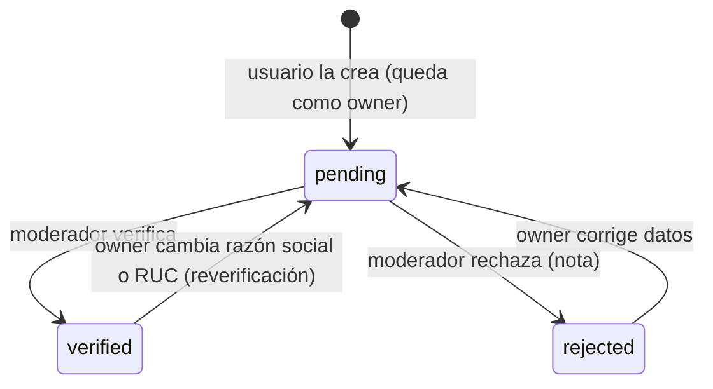
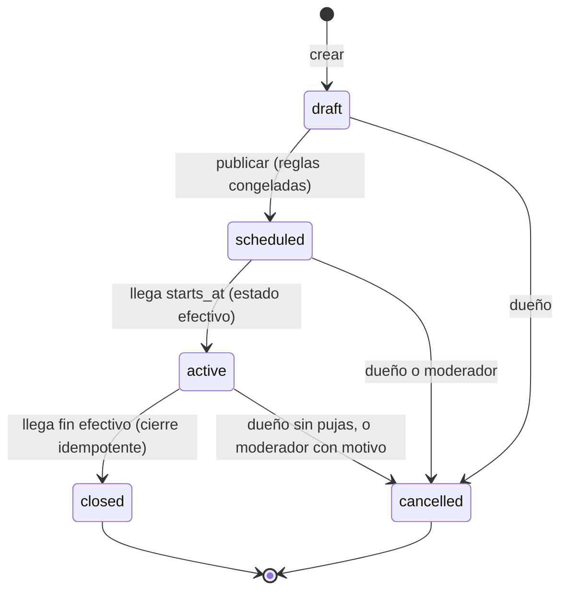
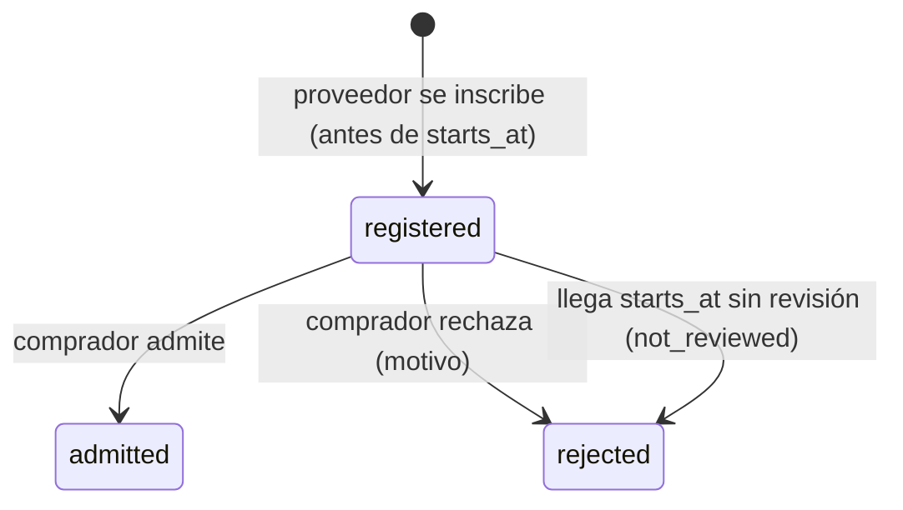
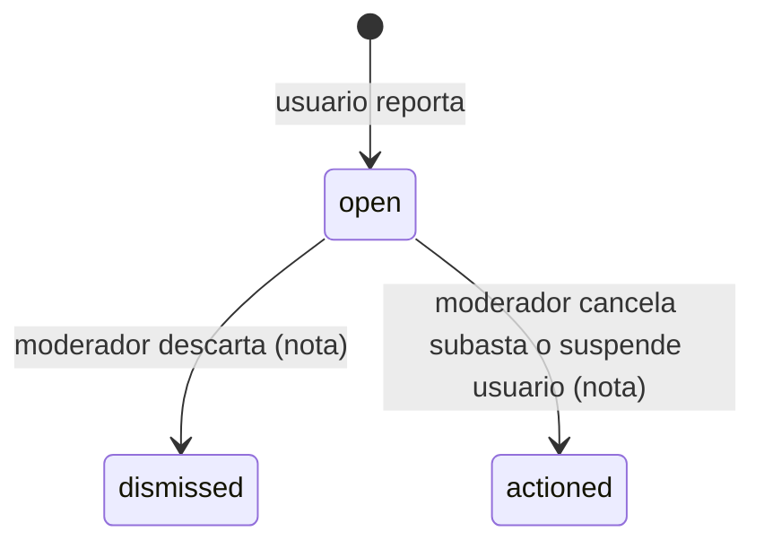
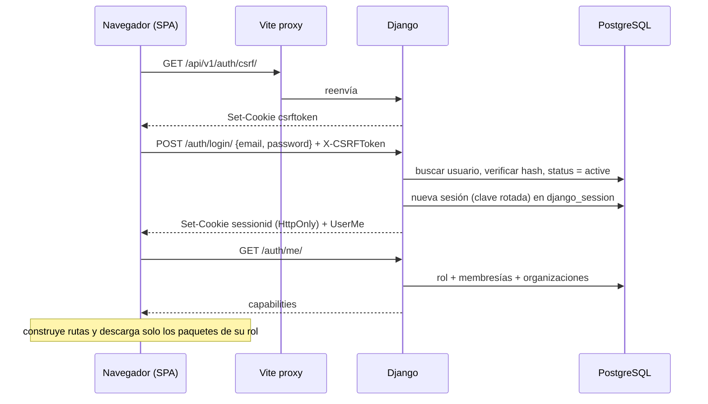

# Funcionamiento del sistema

Cómo opera LANCEX de punta a punta: ciclos de vida de cada entidad y flujos principales. Las reglas exactas están en `REGLAS-DE-SUBASTAS.md`; los permisos, en `ROLES-Y-PERMISOS.md`.

## 1. Vista general en una frase por actor

- El **vendedor** publica un artículo, configura una subasta con reglas que se congelan al publicar y espera; el sistema hace el resto.
- El **postor** puja (o deja un máximo proxy, o una oferta sellada); el servidor valida cada puja en orden estricto y con la hora de PostgreSQL.
- La **organización compradora** publica una necesidad, califica proveedores antes de empezar y deja que compitan a la baja.
- El **proveedor** se inscribe, espera la calificación y oferta si fue admitido.
- El **sistema** abre y cierra subastas por tiempo, determina ganadores, revela lo privado, notifica y audita.
- El **moderador** verifica organizaciones y atiende reportes; el **admin** gobierna usuarios, categorías y auditoría.

## 2. Ciclos de vida

### Cuenta de usuario



### Organización



Mientras una organización no esté `verified`, no crea subastas inversas ni se inscribe como proveedora. Si vuelve a `pending` con subastas o inscripciones abiertas, estas continúan; no puede crear nuevas.

### Publicación (`listing`)

- Editable mientras no tenga una subasta en `draft`, `scheduled` o `active`. Al publicar la subasta, la publicación queda **bloqueada**.
- Si la subasta termina `unsold` o `cancelled`, la publicación se desbloquea y puede **relanzarse** en una subasta nueva (nunca se reutiliza la anterior).
- Como máximo una subasta no terminal por publicación.

### Subasta



Resultado al cerrar: `awarded` (hay ganador que cumple reserva) o `unsold`. Después de `awarded`: `settlement_status` `pending` → `completed` | `failed`, y luego calificaciones.

### Inscripción en subasta inversa



### Reporte



El reportante recibe una notificación de que su reporte fue atendido, sin detalles de la acción.

## 3. Flujos principales

### 3.1 Sesión



### 3.2 Crear y publicar una subasta ascendente

1. El usuario crea una publicación (y sube imágenes con URL firmada).
2. Crea la subasta en `draft`: el servidor valida parámetros y la matriz mecanismo/cierre/proxy.
3. Publica: dentro de una transacción se verifica que la publicación no tenga otra subasta abierta, se fija `original_ends_at`, se guarda `rules_snapshot` y, si es vela, se generan semilla, compromiso e instante secreto. Estado `scheduled`. Auditoría `auction_published`.
4. Cuando la hora de PostgreSQL alcanza `starts_at`, el estado efectivo pasa a `active` sin intervención.

### 3.3 Puja con proxy

```mermaid
sequenceDiagram
    participant C as Postor C (navegador)
    participant D as Django place_bid
    participant P as PostgreSQL
    participant F as Firestore
    C->>D: POST /auctions/{id}/bids/ {amount} + Idempotency-Key
    D->>D: capacidad bid.place + cuenta activa
    D->>P: BEGIN; SELECT auction FOR UPDATE
    D->>P: now := clock_timestamp()
    D->>P: ¿existe esa Idempotency-Key? (si sí: devolver resultado previo)
    D->>D: effective_status = active, no es dueño ni miembro, no es líder
    D->>D: Ascending.validate_bid (mínimo)
    D->>D: ProxyBidding.apply_bid: compara con el máximo del líder
    D->>P: INSERT bid C (manual) y, si corresponde, bid automática del líder
    D->>P: UPDATE auction (precio, líder, bid_count, version, ends_at si soft close)
    D->>P: INSERT audit_event, notification (outbid)
    D->>P: COMMIT
    D-->>C: 201 {bid, auction, outbid_by_proxy}
    D-)F: on_commit: log técnico (asíncrono)
    Note over C: los demás navegadores ven el cambio en su próximo polling (≤ 2 s)
```

Si dos pujas llegan al mismo tiempo desde backends distintos, la segunda espera el `FOR UPDATE` de la primera y se valida contra el precio ya actualizado.

### 3.4 Cierre

1. Cualquier backend con `close_due_auctions --loop 5` encuentra subastas vencidas con `FOR UPDATE SKIP LOCKED`.
2. `close_auction` (idempotente): calcula pujas válidas (en vela, solo hasta el instante secreto), aplica la reserva, fija `outcome`, ganador y precio, revela lo privado (semilla de vela, ofertas selladas), registra auditoría, crea notificaciones y actualiza el `job_heartbeat` de ese backend.
3. Si ningún backend tiene el job corriendo, la primera consulta a `GET /result/` ejecuta el mismo cierre. Mientras tanto, las lecturas muestran `status = closed` y `result_pending = true`, y ninguna puja tardía se acepta.

### 3.5 Sobre cerrado

Recepción: cada postor crea, reemplaza o retira su única oferta vigente; nadie más ve importes. Cierre: revelación automática, ganador la oferta vigente más alta (empate por `seq`), precio = su propia oferta, reserva aplicada. Después: el ranking se hace visible según la matriz de visibilidad.

### 3.6 Subasta inversa B2B completa

```mermaid
sequenceDiagram
    participant B as Comprador (org verificada)
    participant S as Proveedor (org verificada)
    participant D as Django
    B->>D: crear necesidad + subasta inversa (draft) + publicar
    Note over D: estado scheduled = periodo de inscripción
    S->>D: inscribirse con declaración de cumplimiento
    D->>D: verifica capacidad reverse.register y sin conflicto de interés
    B->>D: admitir / rechazar inscripciones (antes de starts_at)
    Note over D: en starts_at: no revisadas → rejected (not_reviewed); calificación congelada
    S->>D: oferta {unit_price, shipping_cost}
    D->>D: total = ROUND_HALF_UP(unit_price × quantity + shipping, 2) ≤ mejor − decremento
    D-->>S: aceptada; mejor total vigente
    Note over D: cierre: gana el menor total; sin ofertas → unsold (desierta)
    D-->>B: identidades, contacto del proveedor ganador
```

### 3.7 Moderación

1. Un usuario reporta una subasta, publicación o usuario.
2. El moderador revisa en su bandeja la evidencia (pujas con identidades, auditoría) sin acceder a máximos proxy ni ofertas selladas no reveladas.
3. Resuelve: descarta, cancela la subasta o suspende al usuario. Cada acción exige motivo, se audita y notifica a los afectados.

## 4. Qué pasa cuando algo falla

| Falla | Comportamiento |
|---|---|
| Se cae la red del postor a mitad de la puja | Reintenta con la misma `Idempotency-Key`; se registra una sola puja |
| Firestore no responde | Las pujas siguen; logs solo en consola |
| Ningún backend corre el job de cierre | Subastas se muestran cerradas y no aceptan pujas; el resultado se materializa en la primera consulta a `result/` |
| Dos backends cierran a la vez | `SKIP LOCKED` + verificación de estado: un solo cierre |
| Reloj de una laptop desfasado | Sin efecto: la hora es la de PostgreSQL |
| Supabase pausado o caído | La aplicación no funciona (dependencia única aceptada); el frontend muestra "servicio no disponible" con el `request_id` |
| Un usuario es suspendido con subastas en curso | Ver `ROLES-Y-PERMISOS.md` §7 |
