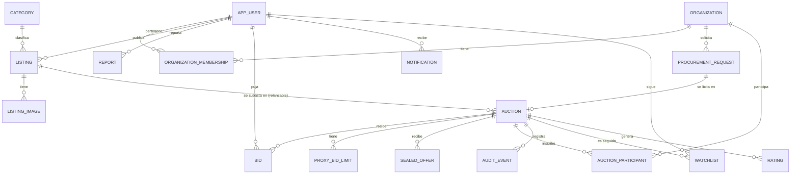

# Modelo de datos (diccionario)

**Estado:** aprobado como base para la migración `supabase/migrations/<timestamp>_baseline_lancex.sql`. Todas las tablas están en el esquema `lancex`. Este documento y el SQL deben coincidir; los modelos Django los reflejan con `managed = False` (ADR-0003).

## Convenciones

- PK `uuid DEFAULT gen_random_uuid()`, salvo tablas de alto volumen (`audit_event`, `notification`) con `bigint GENERATED ALWAYS AS IDENTITY`.
- Dinero `numeric(12,2)`; precio unitario `numeric(14,4)`; cantidades `numeric(14,3)`.
- Instantes `timestamptz`. `created_at DEFAULT now()`. Horas de negocio con `clock_timestamp()` dentro de la transacción.
- Enumerados como `text` + `CHECK`.
- FK con `ON DELETE RESTRICT` por defecto (no se borra historial). Los usuarios se desactivan, no se eliminan.
- Todas las tablas: `ENABLE ROW LEVEL SECURITY` con una única política para `lancex_app` (ADR-0007); `anon`/`authenticated` sin grants ni políticas, y `GRANT` explícitos a `lancex_app`.

## Diagrama entidad-relación

## Identidad

### `app_user`

| Columna | Tipo | Restricciones / notas |
|---|---|---|
| `id` | uuid | PK |
| `email` | varchar(254) | NOT NULL; guardado en minúsculas; índice único sobre `lower(email)` |
| `password` | varchar(128) | NOT NULL; hash de Django |
| `display_name` | varchar(60) | NOT NULL; nombre público |
| `is_active` | boolean | DEFAULT true |
| `platform_role` | text | `user` \| `moderator` \| `admin`; DEFAULT `user` (ver `ROLES-Y-PERMISOS.md`) |
| `status` | text | `active` \| `suspended`; DEFAULT `active` |
| `status_reason` | varchar(300) | NULL; motivo de la última suspensión o reactivación |
| `status_changed_at` / `status_changed_by` | timestamptz / uuid | NULL |
| `last_login` | timestamptz | NULL |
| `bio` | varchar(300) | NULL; presentación pública opcional, sin URLs (migración `20261012230000_perfil_usuario.sql`) |
| `location_city` | varchar(80) | NULL; ciudad pública opcional (misma migración) |
| `created_at` | timestamptz | DEFAULT now() |

### `django_session`

Estructura exacta que espera Django: `session_key varchar(40) PK`, `session_data text NOT NULL`, `expire_date timestamptz NOT NULL` con índice en `expire_date`.

Para poder revocar todas las sesiones de un usuario (suspensión, cambio de rol o de contraseña) se agrega `user_id uuid NULL` con índice, que el backend completa al iniciar sesión mediante un `SessionStore` propio.

### `user_mfa` (**privado**)

Doble factor TOTP activo (`user_id` PK → `app_user`; sin fila = sin 2FA): `secret char(32)` base32 (RFC 6238), `last_step bigint` (anti-repetición), `enabled_at`. El secreto nunca sale del backend tras la activación. Tabla aparte (no columnas de `app_user`) para no cargar el secreto en cada petición.

### `mfa_recovery_code`

Códigos de respaldo de un solo uso: `user_id`, `code_hash char(64)` (SHA-256 del código normalizado, nunca el código), `used_at`, `created_at`.

### `password_reset_token`

Enlace de restablecimiento emitido por un admin: `user_id`, `token_hash char(64)` (SHA-256), `created_by_user_id`, `expires_at` (30 min), `used_at`, `created_at`; `CHECK (user_id <> created_by_user_id)`. Migración: `supabase/migrations/20261014120000_doble_factor_y_reset.sql`.

### `django_cache`

Tabla de `DatabaseCache` de Django (estructura de `createcachetable`: `cache_key varchar(255) PK`, `value text`, `expires timestamptz` con índice), creada por SQL. La usan el bloqueo de login y los límites de login, registro y denuncias para que se compartan entre los tres backends (los límites generales `anon`/`user`/`bids` van en memoria: ADR-0004, Enmienda 1).

### `organization`

| Columna | Tipo | Restricciones / notas |
|---|---|---|
| `id` | uuid | PK |
| `legal_name` | varchar(160) | NOT NULL |
| `ruc` | char(13) | UNIQUE; `CHECK (ruc ~ '^[0-9]{13}$')` |
| `is_buyer` / `is_supplier` | boolean | al menos uno true (`CHECK`) |
| `verification_status` | text | `pending` \| `verified` \| `rejected`; DEFAULT `pending` |
| `verification_note` | varchar(300) | NULL |
| `created_by_user_id` | uuid | FK `app_user` |
| `created_at` | timestamptz | |

### `organization_membership`

`id` uuid PK, `organization_id` FK, `user_id` FK, `role` (`owner` \| `member`), `status` (`active` \| `revoked`), `created_at`. `UNIQUE (organization_id, user_id)`.

## Catálogo

### `category`

`id smallint identity PK`, `name varchar(60) NOT NULL`, `slug varchar(60) UNIQUE`, `is_active boolean DEFAULT true` (las categorías con publicaciones se desactivan, no se borran). Semilla: Vehículos, Tecnología, Hogar y muebles, Maquinaria y equipos, Arte y colección, Inmuebles, Insumos y suministros, Otros.

### `listing` (artículo o lote a vender)

| Columna | Tipo | Notas |
|---|---|---|
| `id` | uuid | PK |
| `owner_user_id` | uuid | FK `app_user` |
| `category_id` | smallint | FK `category` |
| `title` | varchar(120) | NOT NULL |
| `description` | text | NOT NULL; `CHECK (length(description) <= 5000)` |
| `item_condition` | text | `new` \| `used` \| `refurbished` |
| `location_city` | varchar(80) | NOT NULL |
| `created_at`, `updated_at` | timestamptz | |

### `listing_image`

`id` uuid PK, `listing_id` FK, `storage_path text UNIQUE` (ruta en el bucket `listing-images`), `content_type` (`image/jpeg` \| `image/png` \| `image/webp`), `size_bytes int CHECK (size_bytes <= 5242880)`, `position smallint`, `created_at`. Máximo 6 por publicación (regla de servicio).

### `procurement_request` (necesidad B2B)

| Columna | Tipo | Notas |
|---|---|---|
| `id` | uuid | PK |
| `buyer_organization_id` | uuid | FK `organization` (debe ser `is_buyer` y `verified`) |
| `created_by_user_id` | uuid | FK `app_user` |
| `title` | varchar(120) | |
| `specifications` | text | ≤ 5000 caracteres |
| `quantity` | numeric(14,3) | `> 0` |
| `unit` | varchar(20) | |
| `mandatory_requirements` | jsonb | `[{"code":"R1","description":"..."}]`, de 0 a 20 elementos |
| `delivery_deadline` | date | |
| `delivery_location` | varchar(120) | |
| `created_at` | timestamptz | |

## Subastas

### `auction`

| Columna | Tipo | Notas |
|---|---|---|
| `id` | uuid | PK |
| `owner_user_id` | uuid | FK `app_user` |
| `organization_id` | uuid | NULL; compradora en `reverse` |
| `listing_id` | uuid | NULL; obligatorio si `mechanism <> 'reverse'` |
| `procurement_request_id` | uuid | NULL; obligatorio si `mechanism = 'reverse'` |
| `mechanism` | text | `ascending` \| `reverse` \| `sealed` |
| `closing_policy` | text | `fixed` \| `soft_close` \| `candle` (matriz de ADR-0005 en `CHECK`) |
| `proxy_enabled` | boolean | DEFAULT false; solo `ascending` |
| `status` | text | `draft` \| `scheduled` \| `active` \| `closed` \| `cancelled`; DEFAULT `draft` |
| `outcome` | text | NULL \| `awarded` \| `unsold` |
| `currency` | char(3) | DEFAULT `USD`; `CHECK (currency = 'USD')` |
| `starting_price` | numeric(12,2) | ascending/sealed |
| `reserve_price` | numeric(12,2) | NULL; **privado** |
| `min_increment` | numeric(12,2) | ascending |
| `reference_budget` | numeric(12,2) | reverse |
| `min_decrement` | numeric(12,2) | reverse |
| `starts_at`, `ends_at` | timestamptz | `CHECK (ends_at > starts_at)` |
| `original_ends_at` | timestamptz | fijado al publicar (límite de soft close) |
| `soft_close_window_s`, `soft_close_extension_s`, `soft_close_max_total_s` | integer | NULL salvo `soft_close` |
| `candle_window_s` | integer | NULL salvo `candle` |
| `candle_commitment` | char(64) | público tras publicar |
| `candle_seed` | bytea | **privado** hasta el cierre |
| `candle_close_at` | timestamptz | **privado** hasta el cierre |
| `rules_snapshot` | jsonb | congelado al publicar |
| `published_at` | timestamptz | |
| `current_price` | numeric(12,2) | precio líder (ascending: más alto; reverse: total más bajo) |
| `leader_user_id` / `leader_organization_id` | uuid | NULL |
| `bid_count` | integer | DEFAULT 0; también genera `seq` |
| `active_offer_count` | integer | DEFAULT 0; ofertas selladas vigentes |
| `version` | bigint | DEFAULT 0; se incrementa en cada cambio visible (ETag del polling) |
| `winner_user_id` / `winner_organization_id` | uuid | NULL |
| `final_price` | numeric(12,2) | NULL |
| `closed_at`, `cancelled_at` | timestamptz | NULL |
| `cancel_reason` | varchar(300) | NULL |
| `settlement_status` | text | NULL \| `pending` \| `completed` \| `failed` |
| `settlement_note` | varchar(300) | NULL |
| `created_at`, `updated_at` | timestamptz | |

Índices: `(status, ends_at)` para el job de cierre; `(owner_user_id)`; `(listing_id)`; `(mechanism, status)` para el catálogo. Índice único parcial `(listing_id) WHERE status IN ('draft','scheduled','active')`: una publicación tiene como máximo una subasta abierta y puede relanzarse tras `unsold` o `cancelled`.

### `bid` (libro de pujas aceptadas, ascendente e inversa)

| Columna | Tipo | Notas |
|---|---|---|
| `id` | uuid | PK |
| `auction_id` | uuid | FK |
| `seq` | integer | `UNIQUE (auction_id, seq)`; orden oficial |
| `bidder_user_id` | uuid | FK `app_user` |
| `organization_id` | uuid | NULL; proveedor en `reverse` |
| `amount` | numeric(12,2) | importe (ascending) o total calculado (reverse) |
| `unit_price` | numeric(14,4) | NULL; solo reverse |
| `shipping_cost` | numeric(12,2) | NULL; solo reverse |
| `source` | text | `manual` \| `proxy` |
| `proxy_limit_id` | uuid | NULL; FK `proxy_bid_limit` |
| `idempotency_key` | uuid | NULL en pujas automáticas; `UNIQUE (auction_id, bidder_user_id, idempotency_key)` |
| `accepted_at` | timestamptz | `clock_timestamp()` |
| `counted` | boolean | DEFAULT true; false si quedó fuera del corte de vela |

Grants: `lancex_app` con `SELECT, INSERT` y `UPDATE (counted)`. Sin `DELETE`.

### `proxy_bid_limit` (**privado**)

`id` uuid PK, `auction_id` FK, `user_id` FK, `max_amount numeric(12,2)`, `status` (`active` \| `exhausted` \| `cancelled`), `created_at`, `updated_at`. Índice único parcial `(auction_id, user_id) WHERE status = 'active'`.

### `sealed_offer` (**privado hasta el cierre**)

`id` uuid PK, `auction_id` FK, `bidder_user_id` FK, `amount numeric(12,2)`, `seq integer` (mismo contador de la subasta), `is_current boolean`, `status` (`submitted` \| `withdrawn`), `idempotency_key uuid`, `submitted_at timestamptz`, `revealed_at timestamptz NULL`. Índice único parcial `(auction_id, bidder_user_id) WHERE is_current`.

### `auction_participant` (inscripción en subasta inversa)

`id` uuid PK, `auction_id` FK, `organization_id` FK, `registered_by_user_id` FK, `status` (`registered` \| `admitted` \| `rejected`), `compliance jsonb` (`[{"code":"R1","complies":true,"comment":"..."}]`), `decision_reason varchar(300)`, `decided_by_user_id`, `decided_at`, `registered_at`. `UNIQUE (auction_id, organization_id)`.

## Transversales

### `audit_event` (append-only)

| Columna | Tipo | Notas |
|---|---|---|
| `id` | bigint identity | PK |
| `occurred_at` | timestamptz | `clock_timestamp()` |
| `actor_user_id` | uuid | NULL = sistema (job de cierre) |
| `action` | varchar(60) | catálogo en `REGLAS-DE-SUBASTAS.md` §12 |
| `entity_type` | varchar(40) | `auction`, `bid`, `organization`, ... |
| `entity_id` | uuid | NULL |
| `auction_id` | uuid | NULL |
| `request_id` | varchar(64) | mismo valor que el log de Firestore |
| `data` | jsonb | DEFAULT `'{}'`; sin secretos ni importes privados no revelados |

Grants: `lancex_app` solo `INSERT, SELECT`. Trigger `BEFORE UPDATE OR DELETE` que lanza excepción. Índices: `(auction_id, occurred_at)`, `(entity_type, entity_id)`.

### `notification`

`id bigint identity PK`, `user_id` FK, `type varchar(40)`, `auction_id uuid NULL`, `data jsonb`, `created_at`, `read_at NULL`. Índice `(user_id, read_at, created_at DESC)`.

### `watchlist`

`user_id` FK, `auction_id` FK, `created_at`. PK `(user_id, auction_id)`.

### `report` (denuncias)

| Columna | Tipo | Notas |
|---|---|---|
| `id` | uuid | PK |
| `reporter_user_id` | uuid | FK `app_user` |
| `target_type` | text | `auction` \| `listing` \| `user` |
| `target_id` | uuid | |
| `reason` | text | `fraud` \| `prohibited_item` \| `misleading` \| `other` |
| `detail` | varchar(500) | |
| `status` | text | `open` \| `dismissed` \| `actioned`; DEFAULT `open` |
| `resolution_note` | varchar(300) | NULL |
| `resolved_by_user_id`, `resolved_at` | uuid, timestamptz | NULL |
| `created_at` | timestamptz | |

`UNIQUE (reporter_user_id, target_type, target_id)`. Índice `(status, created_at)`.

### `job_heartbeat`

`dev varchar(40) PK` (valor de `DEV_NAME`), `job varchar(40)`, `last_run_at timestamptz`, `last_closed_count integer`. Lo actualiza `close_due_auctions` en cada ciclo; alimenta la pantalla de salud del admin.

### `rating`

`id` uuid PK, `auction_id` FK, `rater_user_id`, `ratee_user_id`, `score smallint CHECK (score BETWEEN 1 AND 5)`, `comment varchar(300)`, `created_at`. `UNIQUE (auction_id, rater_user_id)`.

## Fuente del precio líder

`auction.current_price`, `leader_*`, `bid_count` y `version` son una copia desnormalizada que se actualiza **en la misma transacción** que inserta la puja. El libro `bid` es la fuente para reconstruir y verificar: una prueba recalcula el resultado desde `bid` y lo compara con `auction`.

## Datos de demostración

Comando `python manage.py seed_demo` (solo DML, idempotente, se niega a correr si `APP_ENV=production`): categorías, 6 usuarios de prueba (4 `user`, 1 `moderator`, 1 `admin`; el admin reemplaza a `createsuperuser`), 2 organizaciones verificadas (una compradora, una proveedora) y subastas de ejemplo de cada modalidad con horarios relativos a la hora de PostgreSQL.

## Restricciones adicionales de la migración base

Implementadas en `20261011180000_baseline_lancex.sql` además de lo descrito arriba:

- `app_user.email` en minúsculas (`CHECK`); `display_name` de 3 a 60 caracteres.
- `listing.updated_at`, `auction.updated_at` y `proxy_bid_limit.updated_at` se actualizan por trigger con `clock_timestamp()`.
- `listing_image.position` entre 0 y 5 (máximo 6 imágenes).
- `auction`: matriz de mecanismos (ADR-0005), proxy solo en `ascending`, origen (`listing_id`, o `procurement_request_id` + `organization_id` según mecanismo), parámetros de soft close/vela solo con su política, `outcome` solo en `closed`, `settlement_status` solo con `awarded`; importes entre 0.01 y 999 999 999.99; `procurement_request_id` único.
- `bid`: `source = 'proxy'` si y solo si hay `proxy_limit_id`; las pujas manuales exigen `idempotency_key`.
- `sealed_offer`: `UNIQUE (auction_id, seq)` y `UNIQUE (auction_id, bidder_user_id, idempotency_key)`.
- `rating`: nadie se califica a sí mismo.
- `audit_event`: además de `UPDATE`/`DELETE`, un trigger rechaza `TRUNCATE`.
